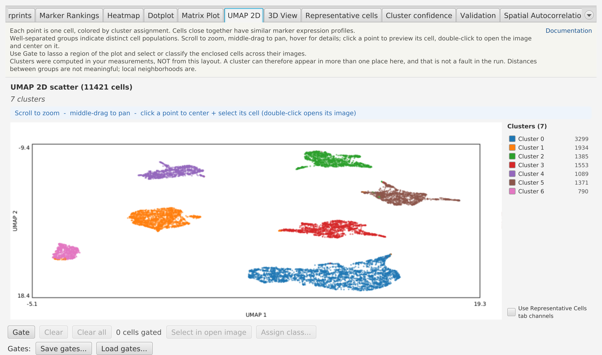
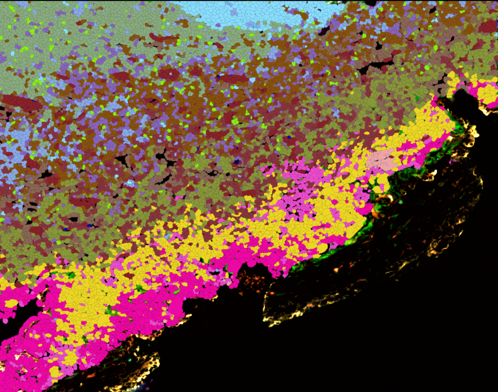

# QP-CAT: Cell Analysis Tools for QuPath

Python-powered cell analysis for highly multiplexed imaging data in [QuPath](https://qupath.github.io/).

Warning: This is a continuation of my work integrating other people's software into QuPath, like with Caleb's [CytoMap](https://forum.image.sc/t/there-and-back-again-qupath-cytomap-cluster-analysis/43352) and Alan's [QuBaLab](https://github.com/qupath/qubalab) (as in [this clustering notebook](https://github.com/saramcardle/FS2K/blob/main/Clustering%20using%20Python.ipynb)), attempting to make clustering and analysis more accessible on the QuPath side, but many of the features are lightly tested or entirely untested! 

QP-CAT embeds a full scientific Python environment (via [Appose](https://github.com/apposed/appose)) directly within QuPath -- no external servers, no conda environments to manage manually, no command-line tools. It provides unsupervised clustering, rule-based phenotyping, autoencoder-based cell classification, dimensionality reduction, spatial analysis, and interoperability export, all accessible through a GUI.


**Repository:** [uw-loci/qupath-extension-cell-analysis-tools](https://github.com/uw-loci/qupath-extension-cell-analysis-tools)

## Documentation

Start at **[documentation/README.md](documentation/README.md)** -- it routes by task.
One page per topic:

| Page | Covers |
|---|---|
| [Setup](documentation/setup.md) | Installing the Python environment, its location, CPU vs GPU |
| [Clustering](documentation/clustering.md) | Running a clustering, and which measurements, normalization and algorithm to choose |
| [Results](documentation/results.md) | The results window: heatmap, embedding, composition, markers, validation |
| [Working with clusters](documentation/clusters.md) | Judging, renaming, merging, sub-clustering, gating |
| [Phenotyping](documentation/phenotyping.md) | Labeling cells by marker rules |
| [Spatial statistics](documentation/spatial-statistics.md) | Neighborhood enrichment, Ripley, Geary, co-occurrence, Moran's I |
| [Neighborhoods](documentation/spatial-neighborhoods.md) | Spatial niches, independent areas, the viewer overlay |
| [Autoencoder](documentation/autoencoder.md) | Classifying cells by appearance |
| [Exporting](documentation/exporting.md) | Figures, AnnData, VEST 3D |
| [Batch runs](documentation/batch.md) | Headless YAML, and what its errors mean |
| [YAML reference](documentation/yaml-reference.md) | Field-by-field config reference |
| [Scripting](documentation/scripting.md) | Groovy API for graph, statistics, export and batch |
| [Reproducibility](documentation/reproducibility.md) | Reproducing a run, and what makes one slow |
| [LLM explainer](documentation/llm-explainer.md) | Cluster naming from an LLM [Experimental] |
| [MCP server](documentation/mcp-server.md) | An AI agent you already use names the clusters; off by default [Experimental] |
| [Troubleshooting](documentation/troubleshooting.md) | Common pitfalls, the Python console, bug reports |
| [Recipes](documentation/recipes.md) | Worked examples |
| [References](documentation/references.md) | Original papers and DOI links for every algorithm and tool used in this extension |

---

## Features

One line each -- what you can *do*, with the method named in small text. Follow
a link for the detail: which algorithm to pick, when to reach for it, and the
caveats.

### Set up

- **[No-setup install](documentation/setup.md)** -- one click configures the full Python environment. No conda, no command line. <sub>~1.5-2.5 GB download, ~2.5 GB on disk</sub>

### Find cell types

- **[Discover cell types without labels](documentation/clustering.md)** -- group cells automatically by marker expression. <sub>Leiden or KMeans to start, HDBSCAN for rare populations, BANKSY when architecture matters; plus 3 more</sub>
- **[Marker gating with auto-thresholds](documentation/phenotyping.md#running-phenotyping)** -- classic flow-cytometry-style cell typing, with a threshold suggested per marker. <sub>Triangle, GMM, Gamma</sub>
- **[Cleaner clusters via tissue context](documentation/clustering.md#spatial-feature-smoothing)** -- blend each cell with its neighbors first, so niches come out as regions, not salt-and-pepper. <sub>Graph convolution; makes any algorithm above spatially aware</sub>
- **[Annotate a few cells, classify the rest](documentation/autoencoder.md)** -- label a small subset and have the rest of the project labeled for you. <sub>Variational autoencoder over marker measurements, image patches, or both; original to QP-CAT, unpublished</sub>
- **[Get a phenotype suggestion in plain English](documentation/llm-explainer.md)** -- a proposed cell-type label per cluster, with a rationale citing the markers. <sub>Any chatbot by clipboard (no key needed), an MCP-capable AI agent (no key; local server, off by default), Anthropic Claude, or a local Ollama endpoint; prompt and response always logged. *[Experimental]; Ollama path never run*</sub>

### Ask spatial questions

- **[Test where cell types live in tissue](documentation/spatial-statistics.md)** -- do two phenotypes co-localize or avoid each other, and at what range? <sub>Neighborhood enrichment, Ripley L, Geary's C, Moran's I, co-occurrence (squidpy); kNN / Radius / Delaunay graphs</sub>
- **[Find cellular neighborhoods](documentation/spatial-neighborhoods.md#cellular-neighborhoods)** -- recurring tissue niches, from the cell-type composition around each cell. <sub>Windowed composition + clustering</sub>
- **[Compare across slides and batches](documentation/clustering.md)** -- clusters that reflect biology, not slide-of-origin or staining day. <sub>Harmony, across a multi-image project</sub>

### Look at results

- **[Click the plot, see the cells](documentation/results.md)** -- brush a region of the embedding and those cells highlight on the slide; double-click to jump to one. <sub>Interactive UMAP / PCA / t-SNE, plus a 3D view</sub>
- **[Gate cells on a 2D plot](documentation/clusters.md#gating-cells-on-a-2d-plot)** -- draw a polygon on any biaxial marker plot and act on what falls inside. <sub>Lasso gating</sub>
- **[Publication-ready follow-up](documentation/results.md)** -- the markers that define each cluster, plotted without leaving QuPath. <sub>Wilcoxon ranking; dotplot, matrix plot, violin, PAGA</sub>
- **[Check that clusters hold up](documentation/results.md#validation-tab)** -- re-run with other seeds, or compare against classes the cells already carry. <sub>Adjusted Rand index, Pixie consistency, NMI, purity, Cohen's kappa; off by default</sub>

### Get results out

- **[Hand off to Python / R](documentation/exporting.md#anndata-for-python)** -- keep going in your usual notebook. <sub>Standard `.h5ad` AnnData; Scanpy, Seurat, cellxgene</sub>
- **[Export every figure in one click](documentation/exporting.md#figure-export)** -- pick the images and the plots, write the lot to a directory. <sub>300 DPI PNG and TIFF (no vector formats); callable from Groovy</sub>
- **[Run in batch from one YAML config](documentation/yaml-reference.md)** -- clustering, phenotyping, spatial stats and figures across a whole project, no GUI. <sub>QuPath's `script` subcommand, inside the extension class loader, so the surface is the dialog's, except the optional Validation checks</sub>
- **[Reproducible audit trail](documentation/reproducibility.md#the-audit-log)** -- every run's parameters, cell counts and results, in plain text. <sub>Per-project log, diff-friendly</sub>

<sub>Batch export and YAML batch mode were inspired by
[OpenIMC](https://github.com/dean-tessone/OpenIMC); QP-CAT's spatial-stats
catalog matches theirs while reusing the squidpy backend it already ships.</sub>

## Requirements

- **QuPath** 0.7.0 or later
- **Java**: nothing to install; QuPath includes its own Java runtime (building from source needs a JDK, see [Building from Source](#building-from-source))
- **Internet connection** for initial environment setup (~1.5-2.5 GB download)
- **Disk space** ~2.5 GB for the Python environment
- **GPU** (optional) -- Clustering, UMAP, and spatial statistics run on CPU. Only the autoencoder uses a GPU when available. You can choose CPU-only (default, installs anywhere) or GPU/CUDA (requires an NVIDIA GPU) at setup time. See [GPU acceleration guide](documentation/setup.md#cpu-or-gpu) for details on what does and doesn't benefit.
- **LLM provider account or local Ollama** (optional) -- for the *Cluster Explainer (LLM) [Experimental]* feature. Nothing is required if you use the "Any chatbot" provider (copy the prompt, paste it into claude.ai / ChatGPT / Gemini / Copilot / your own model, paste the reply back), or if you let an MCP-capable AI agent you already use (Claude Code, Codex, Cursor, Gemini CLI) do the round trip through QP-CAT's local [MCP server](documentation/mcp-server.md), which is off until you start it and has so far connected only to Claude Code and a Python test client, on Linux. Alternatively, choose: (a) an Anthropic API key from [console.anthropic.com](https://console.anthropic.com/), entered in the Cluster Explainer tab each session (held in memory only -- never written to disk); (b) a running [Ollama](https://ollama.com/) instance reachable from your machine (default `http://localhost:11434`). OpenAI is not supported.

---

## Installation

### From the LOCI extension catalog (recommended)

Installing from the catalog is the only route that tells you when an update is available.

1. In QuPath, go to **Extensions > Manage extensions**
2. Click **Manage extension catalogs**, then **Add**, and enter `https://github.com/uw-loci/qupath-catalog-mikenelson`
3. Install **QP-CAT Cell Analysis Tools** from the list, then restart QuPath
4. Go to **Extensions > QP-CAT > Setup & help > Set up analysis environment (first run)...** and click **Setup Environment**
5. Wait for the Python environment to build (first time only, 5-15 minutes, mostly download; see [Setup](documentation/setup.md))

### From GitHub Releases

1. Download the latest `-all.jar` from the [Releases](https://github.com/uw-loci/qupath-extension-cell-analysis-tools/releases) page
2. Drag the JAR onto the QuPath window, or place it in your QuPath extensions directory
3. Restart QuPath
4. Continue from step 4 above

A jar installed this way does not get update notices.

### Building from Source

QP-CAT depends on [cluster3d-core](https://github.com/uw-loci/cluster3d-core), which is not on a public Maven repository, so publish it to your local Maven repository first:

```bash
git clone https://github.com/uw-loci/cluster3d-core.git
(cd cluster3d-core && ./gradlew publishToMavenLocal)
git clone https://github.com/uw-loci/qupath-extension-cell-analysis-tools.git
cd qupath-extension-cell-analysis-tools
./gradlew build
```

Copy `build/libs/qupath-extension-cell-analysis-tools-<version>-all.jar` to your QuPath extensions directory. To compile without running the tests, use `./gradlew compileJava`.

---

## Quick Start

1. Open a project and an image with cell detections (run cell detection first if needed; no data yet? see [Sample data](#sample-data))
2. **Extensions > QP-CAT > Find cell populations (clustering)...** The first time, QP-CAT asks you to back up the project before it changes any classifications; confirm to continue
3. In **Measurements**, click **Select 'Mean' only**, or tick the measurements you want. Nothing is ticked the first time; later runs start with your last selection
4. Choose algorithm (Leiden recommended) and click **Run Clustering**
5. The cells take the classes **Cluster 0**, **Cluster 1**, ... in the viewer, and the results window opens
6. View interactive heatmaps, scatter plots, and marker rankings in the results window

For even faster exploration, use **Extensions > QP-CAT > Explore & spatial > Quick clustering presets**, which run with sensible defaults.

### Sample data

No data of your own yet? Try the
**[multiplex synthetic dataset](https://github.com/uw-loci/multiplex-synthetic-data)**
-- a small, fully ground-truthed synthetic multiplexed dataset (8 images, 8
channels, 7 cell types in schematic tissue niches). Every cell has a known type,
marker positivity, and tissue region, so you can run clustering, phenotyping,
spatial statistics, or batch correction and check the result against the truth.
Download the dataset from its
[latest release](https://github.com/uw-loci/multiplex-synthetic-data/releases/latest).
The BINA / I2K 2026 workshop uses the earlier
[v1.2](https://github.com/uw-loci/multiplex-synthetic-data/releases/tag/v1.2)
(six cell types, aSMA instead of CD31).

---

<details>
<summary><h2>Clustering</h2></summary>

### Supported Algorithms

| Algorithm | Type | Auto-detects k? | Notes |
|-----------|------|:---:|-------|
| **Leiden** | Graph-based | Yes | Recommended default. Resolution parameter controls granularity. |
| **KMeans** | Centroid-based | No | Requires specifying number of clusters. |
| **HDBSCAN** | Density-based | Yes | Also identifies noise cells; they stay unclassified and are counted separately, e.g. "5 clusters (+606 noise)". |
| **Agglomerative** | Hierarchical | No | Supports ward, complete, average, and single linkage. |
| **MiniBatch KMeans** | Centroid-based | No | Scalable variant of KMeans for very large datasets. |
| **GMM** | Probabilistic | No | Gaussian mixture model with soft cluster assignment. |
| **BANKSY** | Spatially-aware | Yes | Uses both expression and spatial coordinates. See [Spatial Clustering](#banksy-spatial-clustering). |

### Normalization Methods

| Method | Description | When to use |
|--------|-------------|-------------|
| **Z-score** | Zero mean, unit variance per marker | Recommended default for most analyses |
| **Min-Max** | Scale each marker to [0, 1] | When relative intensities matter |
| **Percentile** | Robust min-max using 1st/99th percentiles | When outliers are present |
| **None** | Raw measurement values | Pre-normalized data |

### Dimensionality Reduction

UMAP, PCA, and t-SNE embeddings are computed alongside clustering and added as measurements (e.g., `QPCAT 2D UMAP1`, `QPCAT 2D UMAP2`) to each detection. These can be used for visualization in QuPath or downstream tools.

**Explore & spatial > Map cells in 2D (UMAP / PCA / t-SNE)...** computes an embedding without clustering, preserving existing classifications.

### Multi-Image Project Clustering

Select "All project images" scope in the clustering dialog to cluster detections across your entire project simultaneously. This ensures globally consistent cluster assignments. Optionally enable **Harmony batch correction** to remove per-image technical variation before clustering.

### Batch correction (Harmony)

QP-CAT integrates [harmonypy](https://github.com/slowkow/harmonypy) (the Python port of [Harmony](https://github.com/immunogenomics/harmony), Korsunsky et al. 2019, *Nature Methods*) to remove technical variation before clustering. When enabled, you choose the grouping level: **Images** (multi-slide projects with per-slide batch effects) or **Independent areas** (TMA core-by-core or section-by-section variation within a single image).

**When the checkbox is enabled in the Clustering dialog:**

- Two or more images are in scope (**All project images**, or **Specific images...** with two or more chosen), OR independent areas are configured (Independent areas > Add level), AND
- The harmonypy package was successfully imported when the QP-CAT Python environment started.
- A **"Batch key" dropdown** appears below the checkbox to choose the grouping level.

**When the checkbox is grayed out:**

- Fewer than two images are in scope and no independent areas are configured -> there is only one batch, so there is nothing to correct.
- harmonypy failed to install in the Python environment -> the tooltip on the disabled checkbox links you here.

**Platform support matrix:**

| Platform | Harmony version installed | Status |
|---|---|---|
| Linux x86_64 | harmonypy 0.2.0 (pure Python) | Supported |
| macOS (Intel + Apple Silicon) | harmonypy 0.2.0 (pure Python) | Supported |
| Windows x86_64 | harmonypy 0.2.0 (pure Python) | Supported |

QP-CAT pins `harmonypy >= 0.2.0, < 2`. Version 2.0.0+ is a pybind11/CMake build with no Windows wheel, which would force users to install MSVC Build Tools to use this feature. The 0.2.x series is the latest pure-Python release with the same `run_harmony()` API.

**If the checkbox is unexpectedly grayed out:**

1. Open QuPath's log (**View > Show log**) or **Extensions > QP-CAT > Setup & help > Python Console**. (**System Info...** does not list harmonypy.)
2. Look for the startup line `harmonypy: <version>` -- if you instead see `harmonypy: NOT INSTALLED`, the env build skipped or failed for this package.
3. **Use Extensions > QP-CAT > Setup & help > Rebuild analysis environment** to delete and re-create the pixi env from a clean slate. This re-resolves the harmonypy pin and should produce a working install.
4. If rebuild still fails, file a bug report with the full QuPath log attached.

</details>

---

<details>
<summary><h2>Phenotyping</h2></summary>

Rule-based cell type classification using marker gating thresholds.

### Workflow

1. **Extensions > QP-CAT > Classify cells > Label cells by marker rules (phenotyping)...**
2. Select markers to use as gating channels
3. Set per-marker gate thresholds (manually or via auto-thresholding)
4. Define phenotype rules: each rule maps a cell type name to marker conditions (positive/negative)
5. Rules are evaluated in order (first match wins); unmatched cells are labeled "Unknown"

### Auto-Thresholding

Click **Compute Thresholds** to calculate suggested gate values for each marker using three methods:

| Method | Algorithm | Best for |
|--------|-----------|----------|
| **Triangle** | Geometric method from histogram shape | Skewed distributions with dominant negative peak |
| **GMM** | 2-component Gaussian mixture model | Bimodal distributions |
| **Gamma** | Gamma distribution fit (GammaGateR-inspired) | Right-skewed, strictly positive marker data |

Select a marker column header to view its histogram with an interactive draggable threshold line.

Triangle and GMM fit only the values between a spike of identical values (for example, many cells at exactly 0) at either end of the range; an end value counts as a spike when at least 0.5% of cells sit exactly on it. A suggestion that marks more than 95% or fewer than 5% of cells positive is flagged under the histogram counts, and **Apply to All Markers** names the flagged markers. The threshold and gate boxes show up to four decimals. Details in [Phenotyping](documentation/phenotyping.md#auto-thresholding).

### Saving and Loading Rule Sets

Phenotype rules, gates, and marker selections can be saved to and loaded from the QuPath project directory (`<project>/qpcat/phenotype_rules/`). This allows reuse across sessions and sharing between team members.

</details>

---

<details>
<summary><h2>Spatial Analysis</h2></summary>

When enabled in the clustering dialog, QP-CAT computes spatial statistics over cell centroid coordinates. It covers the catalog OpenIMC ships (Ripley L, Geary's C, neighborhood enrichment, co-occurrence) on top of squidpy. One graph constructor, set in the dialog, defines the neighbors for neighborhood enrichment, Moran's I and Geary's C; Ripley L and co-occurrence work from the cell coordinates and use no graph.

### Available statistics

- **Neighborhood enrichment** -- a z-score per cluster pair showing which clusters tend to co-localize (or avoid each other) in tissue space, shown with the number of graph edges behind it, e.g. `7.3 (6061)`. With several images or areas, labels are shuffled within each one, so composition differences between images do not read as neighborhood structure. The heatmap is on the **Neighborhood Enrichment (plot)** tab
- **Ripley's L** -- cumulative distance distribution of a cluster around itself, read against a band simulated from complete spatial randomness for that cluster's cell count. The chart plots each curve relative to its simulated median, so randomness is the line at zero: above it means clustering at that radius, below means dispersion
- **Geary's C** -- per-marker spatial autocorrelation. Sensitive to short-range / local patterns; complements Moran's I which weights long-range structure more heavily
- **Moran's I autocorrelation** -- per-marker spatial autocorrelation
- **Co-occurrence** (pairwise + one-vs-rest) -- how often cluster A is found within distance r of cluster B across a range of r. Pairwise gives every cluster against every other cluster; one-vs-rest collapses "all other clusters" into a single comparison

Results live in their own tabs in the clustering results dialog and are saved with the result, so **Results & populations > View Past Results...** re-draws the same charts and tables. Programmatic access via the `qupath.ext.qpcat.scripting` package -- see [Scripting](documentation/scripting.md) for the Groovy API.

### Graph constructor (kNN / Radius / Delaunay)

Spatial statistics need a definition of "neighbor". The clustering dialog exposes this explicitly:

- **kNN** (default) -- each cell is connected to its k nearest neighbors by centroid distance. Default k = 15. Recommended starting point.
- **Radius** -- each cell is connected to every neighbor within a fixed radius (in microns; pixels only if an image in the run has no pixel size). Use when the biology has a natural distance scale (e.g. immune synapse distance ~ 20 microns).
- **Delaunay** -- a triangulation that connects each cell to its geometric neighbors; no k or radius. Optional max-edge pruning drops over-long edges (use for tissue with large gaps).

The same graph backs **spatial feature smoothing** (the pre-clustering step) and **all post-clustering spatial stats** when you turn on **Edit > Preferences > QP-CAT: Run Clustering > Spatial Smoothing: Use Squidpy Graph** (off by default). The shared graph parameters are visible in the dialog and recorded in the audit log on every run.

**BANKSY is independent.** When BANKSY is selected as the clustering algorithm, it keeps its own internal pybanksy neighbor model (the `k_geom` spinner). BANKSY's graph is not surfaced as the kNN/Radius/Delaunay constructor because pybanksy does not expose a "bring your own graph" hook. This is by design and documented in the dialog.

QP-CAT's statistic surface matches [OpenIMC](https://github.com/dean-tessone/OpenIMC)'s spatial-stats catalog (Ripley + Geary + co-occurrence + neighborhood enrichment) while keeping the squidpy backend the extension already ships with -- no new dependencies.

### Permutation tests

Ripley L, Geary's C and Moran's I use permutations, and QP-CAT picks the number **adaptively** by default. Co-occurrence is a ratio with no permutation test; the count is recorded with it only as part of the run record.

| Cell count | Permutations |
|---|---|
| <= 50k | 1000 |
| 50k - 500k | 100 |
| > 500k | 50 |

The chosen value shows next to the result and is recorded in the audit log. Override it in **Edit > Preferences > QP-CAT: Run Clustering > Spatial Stats Permutations** (`qpcat.spatial.permutations`; a positive integer forces that count, 0 keeps it adaptive).

Neighborhood enrichment is also a permutation test, but it always runs 1000 permutations, whatever the cell count or the preference, shuffling cluster labels within each image or area; the line above its table says so.

### BANKSY Spatial Clustering

[BANKSY](https://github.com/prabhakarlab/Banksy_py) integrates spatial neighborhood information directly into the clustering algorithm. It augments each cell's expression profile with a weighted average of its spatial neighbors' expression, then clusters on the combined representation.

**Independent areas:** When you configure independent areas in the **Independent areas** section (e.g., per-TMA-core or per-tissue-section), BANKSY builds its neighbor graph **per area** -- cells in one TMA core never influence cells in another, even if they are in the same image. The global Leiden clustering step that follows still sees the full cell set, so cluster IDs remain comparable across areas. This prevents artificial adjacency between separate pieces of tissue.

Parameters:
- **lambda** (0-1): Weight of spatial vs. expression information (0.2 is a good starting point)
- **k_geom**: Number of spatial nearest neighbors. The algorithm requests `k_geom * (max_m + 1)` neighbors internally, so with default `max_m=1` the effective k is doubled. QP-CAT automatically caps k_geom to fit each area's cell count.
- **resolution**: Leiden resolution for the final clustering step

**pybanksy dependency:** BANKSY clustering requires the [pybanksy](https://github.com/prabhakarlab/Banksy_py) Python package. If pybanksy failed to import when the QP-CAT Python environment started, the **Run Clustering** button will be disabled when BANKSY is selected, with an explanation message.

**If BANKSY selection shows an error:**

1. Open QuPath's log (**View > Show log**) or **Extensions > QP-CAT > Setup & help > Python Console** to see why pybanksy failed to import. (**System Info...** does not list pybanksy.)
2. Look for the line `pybanksy: <version>` or `pybanksy: NOT USABLE` in the startup messages.
3. **Use Setup & help > Rebuild analysis environment** to delete and re-create the pixi env from a clean slate. This re-resolves all dependencies and should produce a working pybanksy install.
4. If rebuild still fails, file a bug report with the full QuPath log attached.

### Spatial Feature Smoothing

Spatial feature smoothing is a graph convolution pre-step that can be enabled for **any** clustering algorithm. When enabled, each cell's features are smoothed with its spatial neighbors before clustering, encouraging nearby cells to receive similar cluster assignments.

How it works:
1. A k-nearest neighbor graph is built from cell centroid coordinates
2. The adjacency matrix is row-normalized so each cell's neighbors contribute equally
3. Each cell's feature vector is replaced by a weighted average of itself and its neighbors
4. The smoothed features are then passed to the selected clustering algorithm

Enable the **"Spatial feature smoothing"** checkbox in the clustering dialog. The parameter **k** controls the number of spatial nearest neighbors (default 15).

This is a lighter-weight alternative to BANKSY when you want spatial awareness without switching to a fully spatial algorithm.

</details>

---

<details>
<summary><h2>Cluster Explainer (LLM) [Experimental]</h2></summary>

**Cluster results dialog > Cluster Explainer (LLM) [Experimental] tab** turns each cluster's top-marker statistics into a plain-English phenotype suggestion with rationale. The LLM reads only the per-cluster marker rankings -- no pixels, no cell-level data, no patient-identifiable information. For research use only; a suggested phenotype is a hint to check against the markers, not a diagnosis.

> **[PARTIALLY TESTED]** The "Any chatbot", "MCP server" and "Anthropic (Claude API)" paths have been run end-to-end (details below). Ollama has never been run, by anyone. In all cases, the OUTPUT is unvalidated -- treat any phenotype suggestion as provisional and validate it independently before relying on it. The surface area (prompt template, output JSON, audit-log row shape) may also change. The audit log is the canonical record of every call. Both Java and Python sides scrub `Authorization:` headers and `sk-ant-*` keys before any payload reaches the log.

**What has been run, per provider.** *Any chatbot (copy prompt, paste reply)*: run end-to-end on 2026-10-12 -- prompt copied from the tab, answered by a Claude model outside QuPath, reply pasted back, six clusters from the synthetic demo dataset. *MCP server (AI agents)*: run end-to-end on 2026-10-13 on Linux with a Python MCP client; Claude Code connected but no agent has yet run the three calls itself; other clients unverified; see [MCP server](documentation/mcp-server.md). *Anthropic (Claude API)*: run end-to-end against the live API with a real key -- `claude-sonnet-5`, seven clusters, 23 seconds, on 2026-09-27. *Ollama*: never run, by anyone. If you try Ollama first, a failure is as likely to be ours as yours, so please report it.

Inspired by [OpenIMC](https://github.com/dean-tessone/OpenIMC)'s LLM phenotyping; QP-CAT's variant adds two no-key paths (clipboard and MCP), uses Anthropic or Ollama for the API paths (not OpenAI), reads marker statistics only (no pixels, no patient metadata), and writes a full prompt+response audit log on every call. See [the LLM explainer documentation](documentation/llm-explainer.md) for the workflow.

### Providers

| Provider | Pros | Cons | Default model |
|---|---|---|---|
| **Any chatbot (copy prompt, paste reply)** | No key, no installation, works with any LLM (claude.ai, ChatGPT, Gemini, Copilot, Ollama, local model) | Multi-step workflow (copy → paste into chatbot → paste back) | — (user types chatbot name for the record) |
| **MCP server (AI agents)** (not in the Provider box; the agent starts it, see [MCP server](documentation/mcp-server.md)) | No key; the agent does the whole round trip from one sentence you type; explanations saved into the result | Needs an MCP-capable agent (Claude Code, Codex, Cursor, Gemini CLI); a local server you start and stop, with a [security model](documentation/mcp-server.md#security) to read; only Claude Code and a Python test client, on Linux, have connected so far | — (the agent supplies its own label for the record) |
| **Anthropic (Claude API)** | Hosted; structured output via tool use | Costs money per call; key must be re-entered each session | `claude-sonnet-5` (the Model box is editable -- type any id the provider accepts) |
| **Ollama (local)** | Free, offline, no key needed, no data leaves your machine | Quality varies with chosen model; must run an Ollama server | `llama3.1:8b` (or any model you have pulled) |

OpenAI is intentionally **not** supported.

### How It Works

1. After clustering completes (or after "View Past Results"), open the **Cluster Explainer (LLM) [Experimental]** tab in the results dialog
2. Pick a provider in the tab (for Anthropic, paste your key)
3. Press **Run Explainer**; one batched LLM call carries all clusters' Wilcoxon marker rankings
4. Read the per-cluster table: suggested phenotype, confidence band, top supporting markers, one-paragraph rationale
5. The full prompt and full response are written to the project audit log at `<project>/qpcat/logs/qpcat_YYYY-MM-DD.log` under the `=== LLM EXPLAIN ===` entry tag

For the no-key paths -- a chatbot by clipboard, or an AI agent through the [MCP server](documentation/mcp-server.md) started under **Setup & help**, which you then tell `Explain the clusters in my latest QP-CAT result` -- see [Provider setup](documentation/llm-explainer.md#provider-setup); the table fills in when the agent writes the names back.

### What the LLM Sees

Per cluster: the cluster id and its top-N markers (default 10) by Wilcoxon score, each as the marker name, the score and the log2 fold change. Nothing else: no cell counts, no expression table, no p-values (the clusters were defined from these same measurements, so a p-value would be circular). The full list of what is and is not in the prompt is in [What the LLM sees](documentation/llm-explainer.md#what-the-llm-sees); over the MCP server the agent additionally sees the result listing (result names, timestamps, cluster and cell counts, a coarse scope) -- see [What text does leave QuPath](documentation/mcp-server.md#the-three-tools-and-exactly-what-each-one-can-do).

### BYO Key Handling

The API key is entered in a TextField on the explainer tab. It is held in memory only for the lifetime of the QuPath session and is never written to disk, never logged, and never written into the saved result. For headless / power-user setups, the key can be supplied via the `QPCAT_ANTHROPIC_KEY` environment variable instead; if set, the TextField is pre-populated as masked text and can be left empty.

See [LLM explainer documentation](documentation/llm-explainer.md) for the full workflow and [guidance on when to trust the output](documentation/llm-explainer.md#when-it-is-worth-using).

</details>

---

<details>
<summary><h2>Autoencoder Cell Classifier</h2></summary>

**Extensions > QP-CAT > Classify cells > Classify cells by appearance (deep learning)...** trains a variational autoencoder (VAE) with a semi-supervised classifier head on cell measurements. Tested and working.

This is an **original QP-CAT implementation**, not a wrapper around a published Python library -- the VAE, the classifier head, the KL annealing schedule and the tile-mode masking were written for this extension -- and it is **unpublished and not peer reviewed**. The design draws on published methods ([References](documentation/references.md#autoencoder-cell-classification)), but this combination has not been through review; validate it on your own data, and describe it as software rather than citing it as a method.

### How It Works

1. Label cells using one or more methods:
   - **Locked annotations** (default ON): draw region, assign class, lock it -- all detections inside inherit the class
   - **Point annotations** (default ON): use Points tool with a class to click on individual cells
   - **Detection classifications** (default OFF): use existing PathClass labels on detections
2. Select one or more project images for training (multi-image for better generalization)
3. The VAE learns a compressed latent representation from all cells
4. A classifier head trained on the labeled subset propagates labels to all cells
5. The trained model can be applied across all images in a project

### Architecture

- **Encoder**: Measurements -> 128 -> 64 -> latent space (configurable dim, default 16)
- **Decoder**: Latent space -> 64 -> 128 -> reconstructed measurements (Gaussian likelihood)
- **Classifier**: Latent space -> class probabilities (semi-supervised)

Follows the scANVI pattern (Xu et al. 2021) adapted for continuous protein measurements.

### Training Modes

- **Semi-supervised** (recommended): Some cells labeled, rest unlabeled. Reconstruction shapes the latent space; labels guide it.
- **Fully supervised**: All cells labeled. Classification drives latent structure.
- **Unsupervised**: No labels. VAE learns reconstruction only (set supervision weight to 0).

### Output

- `AE_0` through `AE_N` measurements: latent features per cell
- `AE_confidence`: classifier confidence score
- PathClass labels: predicted cell type
- Trained model can be applied to other images via "Apply to Checked Images"

### Input Modes

- **Measurements** (default): Uses per-cell measurement values (e.g., mean channel intensities). MLP encoder/decoder. Fast (seconds to minutes on CPU). No GPU required.
- **Tile images**: Uses multi-channel pixel tiles centered on each cell. Convolutional encoder/decoder. Captures spatial morphology and texture that measurements miss. All image channels included automatically. Optionally appends a binary cell mask channel (CellSighter approach, Amitay et al. 2023, Nature Communications). Benefits from GPU; CPU is slower.
- **Hybrid (Tile + Measurements)**: In tile mode, selected measurements can be included as a secondary input alongside pixel tiles. The model uses a Hybrid ConvVAE architecture where convolutional features from the image tile are concatenated with measurement values before the latent space. This combines spatial/morphological information from pixels with quantitative features like Solidity, Area, Circularity, or channel intensities. Select measurements in the measurement panel even when tile mode is active to enable hybrid input.

### Cell Mask Channel (Tile Mode)

When "Include cell mask channel" is checked (default ON), a binary mask of the target cell's ROI is appended as an extra channel. The mask acts as an attention guide:

- 1.0 inside the cell boundary, 0.0 outside
- Neighboring cell pixels are NOT zeroed out -- their context is informative
- The network learns which cell to classify while using spatial context from neighbors
- Based on CellSighter (Amitay et al. 2023) which showed neighbor spillover patterns help classification in multiplexed imaging

For additional discriminative power, morphology measurements such as Solidity, Area, and Circularity can be combined with tile input via the hybrid mode (see [Input Modes](#input-modes)).

### Performance Considerations

| Mode | Dataset Size | Approx. Training Time (CPU) | GPU Benefit |
|------|-------------|----------------------------|-------------|
| Measurements | 1,000 cells | ~30 seconds | Minimal |
| Measurements | 10,000 cells | ~3 minutes | Minimal |
| Measurements | 50,000 cells | ~15 minutes | Moderate |
| Tile images 32x32 | 1,000 cells | ~2-5 minutes | Significant |
| Tile images 32x32 | 10,000 cells | ~20-60 minutes | Significant |
| Tile images 64x64 | 10,000 cells | ~1-3 hours | Required |

These times are rough; the hardware and data they came from were not recorded.

Tile mode is substantially slower than measurement mode because the convolutional network processes spatial pixel data. For large datasets or tile sizes above 32x32, GPU is strongly recommended.

Inference (applying a trained model) is much faster than training -- typically seconds per image regardless of mode.

### Training Features

VAE best practices and training infrastructure:

| Feature | Description | Default |
|---------|-------------|---------|
| **Gaussian NLL** | Learned per-feature variance for heteroscedastic noise (measurement mode) | ON |
| **Cyclical KL annealing** | 4-cycle ramp prevents posterior collapse (Fu et al. 2019) | beta_max=0.5 |
| **Free bits** | Min KL per latent dim prevents dimension collapse (Kingma et al. 2016) | 0.25 nats |
| **LayerNorm** | Per-sample normalization (preferred over BatchNorm for VAEs) | ON |
| **Logvar clamping** | Numerical stability for variance outputs | [-10, 10] |
| **Unsupervised pre-training** | Train reconstruction before classification | 10% of epochs |
| **Label-fraction scaling** | Classification weight scaled by N_total/N_labeled | Auto |
| **Active units monitoring** | Warns on posterior collapse (low active latent dims) | Auto |
| **R-squared diagnostics** | Per-feature reconstruction quality check | Auto |
| **Class weighting** | Inverse-frequency weights for imbalanced populations | ON |
| **Per-class weight spinners** | Manual per-class weight adjustment via individual spinners in the dialog | 1.0 each |
| **Auto-Balance** | Button that computes inverse-frequency weights and populates per-class spinners automatically | -- |
| **Validation split** | Stratified holdout set for monitoring overfitting | 20% |
| **Early stopping** | Stop when val accuracy plateaus; restore best model | Patience=15 |
| **ReduceLROnPlateau** | Halve LR when loss plateaus (standard VAE scheduler) | factor=0.5 |
| **Mixed precision** | FP16 on CUDA for ~2x speedup | Auto (CUDA only) |
| **Gradient clipping** | Prevents exploding gradients | max_norm=1.0 |
| **Adam optimizer** | No weight decay (conflicts with KL regularization) | lr=0.001 |
| **Data augmentation** | Noise + scaling + feature dropout (measurement mode) | ON |

### Current Limitations (Test Feature)

- Fixed encoder architecture (3-layer conv or 2-layer MLP); no architecture tuning
- Training loss displayed in log only, no live chart
- Tile mode with many channels (40+) and large tiles (64x64) can exhaust GPU memory
- Results should be validated before use in published analyses

</details>

---

<details>
<summary><h2>Post-Analysis Outputs</h2></summary>

After clustering, QP-CAT can generate:

| Output | Description |
|--------|-------------|
| **Interactive heatmap** | Cluster-by-marker mean expression with click-to-select |
| **Interactive scatter** | UMAP/PCA/t-SNE plot colored by cluster, zoomable and pannable |
| **Composition by image** | Per-image cluster counts + proportions (table + pie per image); a cluster confined to one image flags an image batch effect. Exportable as PNG + CSV from the tab or the batch exporter |
| **Composition by annotation** | Per-parent-annotation cluster counts + proportions (shown only when annotations were selected as the clustering input). Exportable as PNG + CSV |
| **Marker rankings** | Top differentially expressed markers per cluster (Wilcoxon rank-sum test) |
| **Marker fingerprints** | At-a-glance cluster/channel explorer, 3 toggle views: per-cluster top markers (log2FC bars), per-cluster channels (Viewer-colored chips), and channels->clusters |
| **PAGA graph** | Cluster connectivity/trajectory graph |
| **Dotplot** | Percent of each cluster above 0 in the normalized units (dot size; not "fraction expressing" under z-score) and the mean with each marker scaled 0-1 (color) |
| **Stacked violin** | Expression distributions per cluster, colored by the median in the run's normalized units |
| **Validation** | Optional: stability across seeds (adjusted Rand index, per-cluster consistency) and agreement with the classes the cells already carry (ARI, NMI, purity, kappa) |
| **Neighborhood enrichment** | Table of `z (edges)` per cluster pair, with Copy text / Copy CSV / Save CSV...; heatmap on the **Neighborhood Enrichment (plot)** tab |
| **Spatial scatter** | Cell positions colored by cluster (when spatial analysis enabled) |
| **Per-area composition** | `<name>_areas_summary.csv` -- wide table, one row per area with columns: area name, area type (Image / TMA Core / Annotation-<class>), cell count, cluster count, then cluster fraction and count per column (when independent areas are configured). Written next to the saved result. |
| **Per-area spatial statistics** | `<name>_areas_statistics.csv` -- long table, one row per area / statistic / key (when independent areas are configured). Same column shape as the post-hoc spatial stats CSV, so the two concatenate. |





</details>

---

<details>
<summary><h2>Data Export</h2></summary>

### AnnData (.h5ad)

Export your data to the AnnData format for use with external tools:

- **Extensions > QP-CAT > Export > Export cells for Python / scanpy (AnnData)...**

The exported file includes:
- All selected measurements as the expression matrix
- Cluster assignments (if present)
- Phenotype labels (if present)
- Embedding coordinates (UMAP/PCA/t-SNE if computed)
- Spatial coordinates (cell centroids)

Compatible with Scanpy, Seurat (via SeuratDisk), cellxgene, and other single-cell analysis tools.

</details>

---

<details>
<summary><h2>Cluster Management</h2></summary>

**Extensions > QP-CAT > Results & populations > Modify cell populations (rename, merge, split, sub-cluster)...** opens a dialog for post-hoc cluster organization:

- **Rename** -- Change a cluster's classification name (e.g., "Cluster 3" -> "CD8+ T Cells")
- **Merge** -- Combine two or more clusters into one with a user-specified name
- **Split** -- Separate a merged cluster back into the clusters it was made from, all of them or only some
- **Step back to '<parent>'** -- re-apply the previous version's names to the cells, undoing an edit
- **Put this version on the cells** -- the same move forwards, for any saved version

Changes are applied directly to detection objects across every image the result covers, and
reflected immediately in QuPath's viewer. Each edit is **non-destructive**: it writes a new
saved result, records which result it came from, and leaves the original alone -- so an
iterative session leaves a chain of versions you can step through in either direction. Your
names then appear throughout the Results window (heatmap, embedding legend, composition table
and pies, fingerprints, gallery) and in exported figures and CSVs. Closing the dialog with
names you typed but have not applied asks first, and says how many would be lost.

See [Iterating, and stepping backwards](documentation/clusters.md#iterating-and-stepping-backwards).

</details>

---

<details>
<summary><h2>Configuration Persistence</h2></summary>

### Clustering Configs

Save and load clustering parameter sets (algorithm, parameters, measurement selection, normalization, embedding settings) within a QuPath project. Stored in `<project>/qpcat/cluster_configs/`.

### Operation Audit Trail

Every operation (clustering, phenotyping, embedding, export, threshold computation) is logged with full parameters, timestamps, cell counts, and results to per-day log files at:

```
<project>/qpcat/logs/qpcat_YYYY-MM-DD.log
```

This provides a reproducibility trail -- you can always see exactly what parameters were used for any analysis. Log files are human-readable text.

</details>

---

<details>
<summary><h2>Python Console</h2></summary>

**Extensions > QP-CAT > Setup & help > Python Console** opens a window showing real-time Python stderr/debug output from the embedded Python environment. Useful for:

- Monitoring long-running operations
- Debugging Python-side errors
- Viewing detailed progress messages

The console includes a **Save Log...** button to export its contents to a text file.

</details>

---

<details>
<summary><h2>Python Environment</h2></summary>

QP-CAT manages its own isolated Python environment via [Appose](https://github.com/apposed/appose) and [pixi](https://pixi.sh/). By default, the environment is stored at:

```
~/.local/share/appose/qupath-qpcat/    (all platforms; on Windows, ~ is %USERPROFILE%)
```

See [Where the environment goes](documentation/setup.md#where-the-environment-goes).

**The location is configurable** via **Edit > Preferences > QP-CAT: Python environment > Environment location** (or by setting it before the first download in the setup dialog). This is useful when the home directory is quota-limited, such as on HPC or managed desktops -- point it to scratch or project storage instead. Two separate environments (CPU and GPU variants) can coexist at the same base directory.

### Key Python Packages

| Package | Purpose |
|---------|---------|
| scanpy | Core single-cell analysis framework |
| scikit-learn | KMeans, HDBSCAN, GMM, Agglomerative clustering |
| leidenalg | Leiden community detection |
| umap-learn | UMAP dimensionality reduction |
| squidpy | Spatial analysis (neighborhood enrichment, Moran's I, Geary's C, Ripley L, co-occurrence) |
| harmonypy | Batch correction for multi-sample integration |
| pybanksy | Spatially-aware BANKSY clustering |
| anndata | AnnData format for interoperability |
| torch | Deep learning runtime for the autoencoder classifier |
| scikit-image | Auto-thresholding (Triangle method) |
| scipy | Gamma distribution fitting for auto-thresholds |
| matplotlib | Plot generation |

### Rebuilding the Environment

If the environment becomes corrupted or you need to update packages:

1. **Extensions > QP-CAT > Setup & help > Rebuild analysis environment**
2. Confirm the rebuild (this deletes the existing environment)
3. Click **Setup Environment** in the dialog that appears

</details>

---

<details>
<summary><h2>Menu Reference</h2></summary>

All items are under **Extensions > QP-CAT**. Everything except **Setup & help** appears once the analysis environment is set up.

| Menu Item | Description | Requirements |
|-----------|-------------|--------------|
| Find cell populations (clustering)... | Full clustering dialog with all options | Image + detections |
| Classify cells > Label cells by marker rules (phenotyping)... | Rule-based cell type classification | Image + detections |
| Classify cells > Classify cells by appearance (deep learning)... | Train a VAE classifier, apply across the project | Project + detections + labels |
| Explore & spatial > Quick clustering presets > Quick Leiden (auto) / Quick KMeans (k=10) / Quick HDBSCAN (auto) / Quick Delaunay (Leiden + Delaunay smoothing) / Quick Delaunay (custom)... | One-click clustering with defaults | Image + detections |
| Explore & spatial > Map cells in 2D (UMAP / PCA / t-SNE)... | Embedding without clustering | Image + detections |
| Explore & spatial > Plot & gate cells (2D)... | Biaxial or embedding plot with lasso gating | Image + detections |
| Explore & spatial > Find cellular neighborhoods (spatial niches)... | Recurring tissue niches from neighborhood composition | Classified detections |
| Explore & spatial > Spatial statistics on existing clusters... | Post-hoc spatial statistics | Classified detections |
| Results & populations > View Past Results... / Manage Saved Results... | Reopen or delete saved results | Project |
| Results & populations > Modify cell populations (rename, merge, split, sub-cluster)... | Rename, merge, split and sub-cluster | A saved result |
| Results & populations > Analyze current cell classifications... | Results window for classes the cells already carry | Classified detections |
| Results & populations > Apply saved result to detections... / Apply cluster color palette... | Write a saved result back; set cluster colors | Project |
| Export > Export figures (batch)... | Multi-Figure Batch Export: pick images + plot kinds + format + DPI + output directory; writes the saved matplotlib plots and the cluster-composition pies / tables in one pass. See [Exporting](documentation/exporting.md#figure-export) | Project + at least one saved clustering result |
| Export > Export cells for Python / scanpy (AnnData)... | Export data for external analysis tools | Image + detections |
| Export > Export cell crops + feature table (TraitHorizon / CSV)... | Cell crops plus a per-cell feature table | Project + detections |
| Export > Export clustered cells for VEST (3D viewer)... / Stop VEST viewer | Standalone 3D viewer | Clustered detections |
| Setup & help > Set up analysis environment (first run)... | One-time Python environment installation | Internet connection |
| Setup & help > Python Console | View Python debug output | None |
| Setup & help > Clear cell connections... | Remove a spatial graph overlay | Image |
| Setup & help > System Info... | Show version and environment details | Environment ready |
| Setup & help > Rebuild analysis environment | Delete and re-download Python environment | None |
| Setup & help > Documentation (How-to guide)... / Report a Bug... | Open the docs; send a bug report | None |
| Setup & help > MCP server for AI agents / Show MCP server window (address and token) | Local MCP server for AI agents (experimental) | Project |

</details>

---

<details>
<summary><h2>Troubleshooting</h2></summary>

### Environment setup fails

- Check your internet connection -- the initial download is ~1.5-2.5 GB
- Check available disk space (~2.5 GB required)
- Try **Setup & help > Rebuild analysis environment** to start fresh
- Check the Python Console for detailed error messages

### "No detections found"

QP-CAT operates on detection objects (cells). Run cell detection first:
- **Analyze > Cell detection** in QuPath, or
- Use StarDist, Cellpose, or another detection method

### Clustering produces unexpected results

- Try different normalization methods -- Z-score is recommended for most data
- Adjust algorithm parameters (e.g., Leiden resolution, HDBSCAN min_cluster_size)
- Check the marker selection -- "Mean" measurements are usually best for clustering
- View the interactive heatmap to assess cluster quality

### Large datasets (hundreds of thousands to millions of cells)

- **QP-CAT refuses doomed configurations before they start.** If you select
  Agglomerative clustering with 1 million cells, or co-occurrence with 60 clusters,
  QP-CAT predicts whether it can finish on *your machine's actual RAM* and refuses
  runs that would crash or hang. The clustering dialog shows this as a red box with
  the reason and an alternative; YAML batch runs fail the image with a clear error
  message. See [Batch: when it fails](documentation/batch.md#when-it-fails)
  for the list of guarded analyses and remedies.

- **A run that seems stuck is usually the embedding.** UMAP dominates wall time at
  this scale. Leave **Dimensionality Reduction > Advanced > "UMAP speed vs
  reproducibility"** on *Automatic*: above 200,000 cells it lets UMAP use every
  CPU core, which is 6-8x faster. (umap-learn switches parallelism off whenever a
  fixed random seed is supplied, so *Reproducible* mode really does run on one
  core.) The mode used is recorded in the audit log.
- **Cancel works only between phases** -- a UMAP fit or Leiden
  partition already in progress has to finish first.
- Use MiniBatch KMeans or Leiden rather than Agglomerative (O(n^2)) or HDBSCAN.
- Enable permutation-based spatial statistics (Ripley, Geary, co-occurrence) only
  for final runs; they are the most expensive step QP-CAT has.
- Reduce the number of selected measurements before reducing the number of cells.
- Consider clustering a subset while exploring (select detections within an
  annotation).
- Above 150,000 cells the embedding scatter plot draws a cluster-stratified
  subsample, stated in the plot title. Clustering still uses every cell.

See [Clustering](documentation/clustering.md)
for the reasoning and sources.

### Cluster Explainer (LLM) issues

The LLM explainer can fail in a handful of well-defined ways: network unreachable, invalid API key, rate limit, malformed response, Ollama endpoint down, Ollama model not pulled, request canceled, or the **Run Explainer** button disabled because no provider is selected in the tab or the clustering result has no Wilcoxon marker rankings. Each error message includes a concrete next step.

See the [LLM explainer troubleshooting section](documentation/llm-explainer.md#troubleshooting) for the full list with what-you-see / what-it-means / what-to-do for every case.

</details>

---

<details>
<summary><h2>Key source files</h2></summary>

A partial map of the main classes and scripts; to build, see [Building from Source](#building-from-source).

```
src/main/java/qupath/ext/qpcat/
  SetupQPCAT.java                 Extension entry point and menu registration
  controller/
    ClusteringWorkflow.java       Orchestrates all analysis operations
  model/
    ClusteringConfig.java         Configuration with enums for algorithms/normalization/embedding
    ClusteringResult.java         Result container with labels, stats, plots, spatial data
    PhenotypeRuleSet.java         Serializable phenotype rule definitions
  preferences/
    QpcatPreferences.java         Extension preferences and persistent settings
  service/
    ApposeClusteringService.java  Appose Python IPC singleton
    MeasurementExtractor.java     Extracts measurements from QuPath detections
    ResultApplier.java            Applies labels/embeddings back to detections
    OperationLogger.java          Per-project operation audit trail
    ClusteringConfigManager.java  Config save/load to project directory
    PhenotypeRuleSetManager.java  Rule set save/load to project directory
    ChannelValidator.java         Cross-image measurement consistency checking
  ui/
    AutoencoderDialog.java        Autoencoder classifier training and inference dialog
    ClusteringDialog.java         Main clustering configuration dialog
    ClusterHeatmapPanel.java      Interactive cluster-by-marker heatmap
    ClusterManagementDialog.java  Rename/merge cluster classifications
    EmbeddingDialog.java          Embedding-only computation dialog
    EmbeddingScatterPanel.java    Interactive 2D embedding scatter plot
    HistogramPanel.java           Interactive histogram with draggable threshold
    PhenotypingDialog.java        Phenotyping rules and gating dialog
    PythonConsoleWindow.java      Real-time Python stderr viewer
    SetupEnvironmentDialog.java   Environment download progress dialog

src/main/resources/qupath/ext/qpcat/
  pixi.toml                       Python environment specification
  scripts/
    compute_thresholds.py         Auto-threshold computation
    export_anndata.py             AnnData export
    infer_autoencoder.py          Autoencoder inference on new data
    init_services.py              Python worker initialization
    model_utils.py                Model save/load and architecture utilities
    run_clustering.py             Clustering pipeline
    run_phenotyping.py            Phenotyping pipeline
    system_info.py                Python environment info collection
    train_autoencoder.py          VAE autoencoder training pipeline
```

</details>

---

## Acknowledgments

Developed at the [Laboratory for Optical and Computational Instrumentation (LOCI)](https://loci.wisc.edu/) at the University of Wisconsin-Madison.

**Key dependencies:**
- [QuPath](https://qupath.github.io/) -- Open-source bioimage analysis
- [Appose](https://github.com/apposed/appose) -- Inter-process communication for polyglot scientific computing
- [Scanpy](https://scanpy.readthedocs.io/) -- Single-cell analysis in Python
- [squidpy](https://squidpy.readthedocs.io/) -- Spatial single-cell analysis
- [BANKSY](https://github.com/prabhakarlab/Banksy_py) -- Spatially-aware clustering
- [Harmony](https://github.com/immunogenomics/harmony) -- Batch correction

---

## Support

For general support and feature requests, please post on the [image.sc forum](https://forum.image.sc/) with the `#qupath` tag and mention `@Mike_Nelson` to flag the topic for my attention.

Found a bug? **Extensions > QP-CAT > Setup & help > Report a Bug...** files it with the log attached, or open an issue on [GitHub Issues](https://github.com/uw-loci/qupath-extension-cell-analysis-tools/issues).

## How to cite

QP-CAT has no paper yet. Cite it by its repository URL and the version you ran (shown in **Extensions > Manage extensions**), and cite the methods you used from [References](documentation/references.md): for example Leiden, UMAP, squidpy or Harmony.

## License

[Apache License 2.0](LICENSE). QP-CAT is a QuPath plugin; when distributed together with
QuPath (GPL-3.0) the combined work is governed by the GPL. Third-party dependencies and
inspirations are recorded in [THIRD_PARTY_NOTICES.md](THIRD_PARTY_NOTICES.md).

## AI-Assisted Development

This project was developed with assistance from [Claude](https://claude.ai) (Anthropic). Claude was used as a development tool for code generation, architecture design, debugging, and documentation throughout the project.
